<!-- ✏️ Replace every YOUR_USERNAME with your GitHub username (Ctrl+F) -->

<p align="center">
  
</p>

<p align="center">
  
</p>

<p align="center">
  <a href="https://www.linkedin.com/in/aramis-fuentes-martinez-aa870026a/"></a>
  <a href="mailto:you@example.com"></a>
  
</p>


###  &nbsp;About me

```python
class Aramis:
    role      = "Systems Engineer · Software Developer · AI & Fullstack"
    based_in  = "Cochabamba, Bolivia 🇧🇴"
    studies   = "Universidad Católica Boliviana"
    focus     = ["Frontend", "UI/UX", "AI", "Fullstack"]
    stack     = ["React", "Python", "FastAPI", "JavaScript", "SQL", "Docker"]
```


<p align="center">
  
</p>


###  &nbsp;GitHub stats

<p align="center">
  
  
</p>
<p align="center">
  
</p>

<p align="center">
  
</p>
